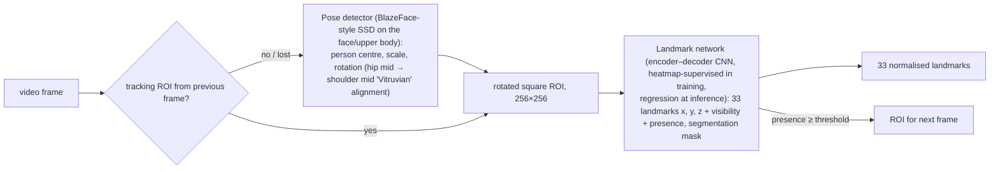

# FormFit computer vision: methods, evaluation and limits

This document covers the computer-vision side of FormFit: the pose model, how landmarks become
reps and form feedback, and how each stage was measured. The numbers in the tables were produced by
`experiments/run.py` with the configs in `experiments/configs/cv_*.json`. Each table names its run
folder under `experiments/results/`.

> **Read the data labels.** Most numbers here come from **synthetic** 3-D skeleton sequences
> (`backend/cv/skeleton.py`). They have exact ground truth, but they are not real people or real
> MediaPipe output. Numbers on **real** video use the single bundled clip and an earlier 11-clip
> run. Real-video landmark "accuracy" is agreement with MediaPipe's largest model, not with human
> labels. Every table says which kind it is.

## 1. Image classification vs object detection vs pose estimation

| | Image classification | Object detection | Pose estimation |
|---|---|---|---|
| Question | *What* is in the image? | *What* and *where* (box)? | *Where* is each body **joint**? |
| Output | one label (or label distribution) per image | N × (box x, y, w, h + class + score) | per person: K keypoints (x, y [, z]) + confidence each |
| Typical head | global pooling → softmax | box regression + classification per anchor/query | heatmaps (one per joint) or direct coordinate regression |
| Loss | cross-entropy | classification + box (L1 / IoU) | heatmap MSE or coordinate L1, often + visibility BCE |
| Metric | accuracy, F1 | mAP over IoU thresholds | PCK, OKS-based AP, NME |
| FormFit use | – (would need labelled rep videos and says nothing about form) | first stage only: finding the person | the core signal: joint angles, reps and form |

They build on each other. A pose system usually **detects** the person first, then **regresses
keypoints** inside the box. A per-frame exercise **classifier** can then run on the keypoints
instead of on pixels. That is what FormFit does in §5, and it is much cheaper than classifying raw
frames. It is also more robust to clothing and backgrounds, because those never reach the
classifier. The price is that every error of the pose model propagates downstream.

Why pose estimation and not classification on pixels for this app: counting reps and judging form
needs *geometry* (a knee angle of 70° vs 110°), which a class label cannot express. Keypoints are also tiny
(33 × 3 numbers per frame), so everything after the pose model runs in well under a millisecond in
the browser and never needs the video to leave the device.

## 2. Pose estimation architecture (MediaPipe BlazePose / PoseLandmarker)

FormFit uses Google's pretrained **PoseLandmarker** (BlazePose, Bazarevsky et al. 2020). It is not
trained or fine-tuned here. It is a two-stage, top-down, single-person pipeline:



* **Detector.** It runs only when there is no track. It finds the face/upper body and predicts the
  body centre, size and in-plane rotation, so the landmark network always sees an upright,
  centred person. This is why the model is single-person: `numPoses: 1` in `lib/pose-runtime.ts`.
* **Landmark network.** A lightweight CNN regresses 33 keypoints, the BlazePose topology: face 0–10,
  arms and hands 11–22, legs and feet 23–32. During training a heatmap and offset head supervises
  the shared features, and at inference only the regression head runs, which is fast. Each landmark has
  a **visibility** probability (in the image and not occluded) and the pose has a **presence** score.
* **Tracking.** In VIDEO mode the ROI for frame *t+1* comes from the landmarks of frame *t*. The
  detector reruns only when presence drops below `minTrackingConfidence`. This is why VIDEO mode is
  faster than IMAGE mode and why a lost track costs one slower frame.
* **Variants.** `lite`, `full` and `heavy` share the pipeline and differ in landmark-network
  capacity (5.6 / 9.4 / 30.7 MB files). Their speed and agreement are measured in §7.
* **Coordinates.** x is divided by the image width and y by the image height. z is relative depth
  and is not used, because it is too noisy for a monocular webcam.

## 3. Landmarks → geometry

| Step | Where | What |
|---|---|---|
| Landmark detection | `lib/pose-runtime.ts` | 33 landmarks per frame, GPU delegate with CPU fallback, WASM served locally |
| **Landmark guard** (new) | `pose/guard.ts` | left/right swap repair, implausible-joint rejection, short-gap filling (§6) |
| Coordinate normalization | `pose/engine.ts` (aspect), `backend/cv/normalize.py` (classifier) | see below |
| Joint angles | `pose/angles.ts`, `pose/rules.ts` | interior angle ABC = arccos((a−b)·(c−b) / ‖a−b‖‖c−b‖) on aspect-corrected 2-D points; torso lean = angle of hip→shoulder from vertical; hip line = shoulder–hip–ankle angle; valgus = knee width / ankle width |
| Temporal smoothing | `pose/angles.ts` | One Euro filter per signal |
| Rep counting | `pose/fsm.ts` | hysteresis state machine `top → down → bottom → top` with min/max rep time and partial-rep detection |
| Posture evaluation | `pose/rules.ts` | 17 per-exercise fault rules on per-rep features, gated by tracking confidence |

**Coordinate normalization.** Raw landmarks depend on the image size, where the person stands, how
far away they are and the camera's rotation, and none of that says anything about the movement.

1. *Aspect correction:* `x *= width / height`. Without it, every angle in a 16:9 video is distorted.
   This was a real bug, found on a real clip.
2. *Translation:* subtract the hip midpoint.
3. *Scale:* divide by a body size, `max(torso, ½·hip-to-ankle, shoulder width)` per frame with the
   median over the window. The torso alone collapses when it points at the camera, as in a push-up
   filmed from the front.
4. *Mirror augmentation* (training only): `x → −x` with left/right indices swapped.
5. **Rotation is not normalised on purpose.** Gravity ("down" in the image) is what separates a
   push-up from a squat.

The rule engine needs only steps 1 and 2, because angles are scale-invariant. The exercise
classifier uses all of them (`backend/cv/normalize.py: frame_features`, 51 features: normalised
x/y and visibility of 12 body joints, 8 joint angles, trunk angle, shank angles, a view cue and
wrist height).

## 4. Synthetic 3-D ground truth (`backend/cv/skeleton.py`)

There is no downloadable dataset that has, for the same videos, keypoints, rep boundaries,
exercise labels and form-fault labels across many camera angles. So the evaluation uses a 3-D
kinematic generator:

* **Bodies:** height 1.55–1.95 m, Winter (2009) segment ratios ± 5%.
* **Movement:** forward kinematics plus two-bone IK for 5 exercises, with per-rep depth, tempo and
  injected faults. Examples: squat valgus, heel lift and balance-driven lean; push-up sag/pike and
  elbow flare; curl drift and swing; press arch and short lockout; lunge depth and lean. There are
  also 5 non-exercise distractors: idle, marching, arm waving, hip hinge and walking across.
* **Camera:** pinhole projection at any yaw (0° = facing, 90° = side), height 0.5–1.5 m,
  45–65° FOV, landscape or portrait.
* **Detector error model:** AR(1) pixel noise of 0.3–1% of body height, visibility from
  self-occlusion, occluder boxes (25% of sequences), detection dropouts, left/right swap episodes in
  side views, and badly framed shots.
* **Labels from the true 3-D pose** with the same thresholds as `pose/rules.ts`. The engine sees
  only the noisy 2-D projection, so projection effects count as errors, as they would with a real camera.

Splits (independent seeds): `train` 2,000, `val` 400, `test` 800 sequences; `test_hard` 600 (noise
1.2–2.5%, occluders in 70%); `sweep` 600 (5 exercises × 8 yaws × 15, no occluders).
Regenerate them with `python -m cv.dataset ...` (see `experiments/configs/cv_classification.json`).

## 5. Exercise classification: pose-based vs temporal (advanced comparison)

Run: `experiments/results/20261126-143915-cv_classification` (**synthetic**). Six classes: 5 exercises
plus `other` (idle, marching, arm waving, hip hinge, walking). Windows are 2 s (30 frames at 15 fps).

| Model | What it sees | How |
|---|---|---|
| **frame** (pose-based) | one frame's 51 features | gradient-boosted trees; window = mean of 30 frame probabilities, so the order of frames is invisible |
| **stats** | the window, summarised | mean / std / min / max / mean \|velocity\| of the angle and position features → gradient-boosted trees |
| **tcn** (temporal) | the window, frame by frame | 1-D temporal CNN: 3 dilated conv layers (k = 5, 5, 3; dilation 1, 2, 4; 48 channels; receptive field 23 frames ≈ 1.5 s), global average + max pooling, linear head. 31,398 parameters. Trained with JAX (AdamW, 2,500 steps, augmentations: time warp 0.8–1.25×, feature noise, whole-joint dropout, mirroring) |

Macro F1 (accuracy in brackets):

| Protocol | frame (pose-based) | stats | tcn (temporal) |
|---|---|---|---|
| Standard test, 17,007 windows | 0.993 (0.993) | **0.998** (0.998) | 0.996 (0.996) |
| Hard test: 2–3× landmark noise, occluders in 70% of sequences | 0.981 | 0.940 | **0.985** |
| 1-second windows (15 frames, resampled) | **0.987** | 0.956 | 0.961 |
| **Cross-view**: trained on side/oblique cameras only, tested on front/rear | 0.811 | **0.960** | 0.942 |
| Sequence level (majority vote over windows) | 0.995 acc. | 1.000 | 1.000 |
| `other` class F1 on the hard test | 0.941 | 0.832 | **0.965** |
| Latency per window, CPU, batch 1 | 16.2 ms | 6.5 ms | **0.16 ms** (NumPy), 0.9 ms (TypeScript in Node) |

What this shows:

* **On clean data from familiar viewpoints all three are near-perfect.** The synthetic exercises are
  very distinct, so on in-distribution data this benchmark separates the models less than real
  footage would.
* **Generalising to an unseen viewpoint is where a single frame fails.** A frontal squat frame looks
  nothing like a side-on one, so the per-frame model drops to F1 0.81. Both temporal models drop
  only to 0.94–0.96, because *how the joints move* (which angle oscillates, at what rhythm) changes
  less with the viewpoint than the static shape does.
* **Under heavy noise and occlusion the learned temporal model is best (0.985)** and is clearly the best at
  telling exercise from non-exercise movement (`other` F1 0.965). The hand-made window statistics
  are the most fragile here (0.94), because a few corrupted frames move the min/max features a lot.
* **With very short windows the single-frame model wins.** One second is less than one rep, and
  the temporal models were trained on 1.6–2.5 s of motion. A real system needs ≥ 2 s of
  context before it trusts the temporal model.
* **Speed:** the TCN is ~100× faster than the tree models on a window because it is a few small
  matrix products, which is why it is the one shipped to the browser (`frontend/public/models/exercise_tcn.json`, 291 KB).

Online use: in the browser the body-size scale comes from the 30-frame window only, not the whole
sequence. With window-only features the TCN scores macro F1 0.996 on 6,451 test windows
(`python -m cv.export_tcn`). A parity test (`pose/__tests__/exercise.test.ts`) checks that the TypeScript
features and probabilities match NumPy to within 2·10⁻³.

**Real video:** on the bundled squat clip every recognised window is classified `squat` (183 of 183). That is one
clip, so it is a sanity check, not a measurement. Real exercise-classification F1 needs labelled
clips of all five exercises and of non-exercise movement: **dataset required**.

## 6. Occlusion handling and incorrect-pose detection (`pose/guard.ts`)

The guard runs on every frame before the rep engine. It works online with no look-ahead and costs
~0.004 ms per frame:

1. **Left/right swap repair.** In side views the network sometimes swaps the near and far leg for a
   few frames. The guard compares the frame with the previous output under the identity and the
   swapped labelling and keeps the cheaper one, a two-hypothesis data association.
2. **Implausible-joint rejection (incorrect pose).** A joint moving faster than 8 torso lengths per
   second is a detection error, so it is marked invisible. If ≥ 5 joints jump at once, the whole frame
   is rejected (for example, the detector jumped to another person).
3. **Short-gap filling.** A joint hidden for ≤ 0.6 s, or a whole dropped frame, is held at its last
   trusted position with visibility 0.55. That keeps the rep in progress, and the reduced
   visibility lowers the rep's confidence, so its form is more likely to be left unscored. Longer gaps are left missing,
   because guessing for longer would invent motion.

Existing confidence-based handling stays in place: missing joints give "Step back…", weak tracking
gives "Can't see your knees clearly", and a low-confidence rep is counted but not scored.

**A real-video finding that motivates the speed check** (`20261126-145152-cv_landmarks`, real frames,
grey boxes over a joint for 82 of 213 frames): MediaPipe keeps reporting covered joints with
visibility **0.71** (0.79 when uncovered), but their positions are wrong: PCK@0.1 **0.15** vs 0.98
for the same joints without a box. **Visibility alone does not detect occlusion by an object**,
because the network hallucinates a plausible joint. Temporal plausibility checks and per-rep
confidence are needed on top.

Effect on rep counting (**synthetic**, `20261126-144743-cv_repcount`):

| | Guard off | Guard on |
|---|---|---|
| Test: count MAE / exact | 1.464 / 49.5% | **1.437 / 52.3%** |
| Test, sequences with an occluder: MAE / exact | 1.895 / 26.8% | **1.758 / 37.9%** |
| Reps missed because of occlusion (test) | 115 | **89** (−23%) |
| Hard test: MAE / exact | 1.679 / 40.1% | **1.584 / 47.0%** |
| Hard test, reps missed because of occlusion | 224 | **168** (−25%) |
| Engine time per frame (Node) | 0.008 ms | 0.012 ms |

The guard is on by default in the app (Train and Upload).

## 7. Landmark detection accuracy, latency and low light (real frames)

Run: `20261126-145152-cv_landmarks`, on `samples/squat_demo.webm` (213 frames at 15 fps, 640×360, a real person).
**Reference = MediaPipe heavy on the unmodified frames.** These are agreement numbers, not accuracy
against human labels. PCK@α: share of the 12 body joints within α × torso length of the reference.

| Model | File | CPU latency / frame (median, p95) | Detection rate | PCK@0.05 | PCK@0.1 | PCK@0.2 | NME |
|---|---|---|---|---|---|---|---|
| **lite** (shipped) | 5.8 MB | **13.2 ms**, 19.1 ms | 100% | 0.518 | 0.887 | 0.980 | 0.059 |
| full | 9.4 MB | 18.1 ms, 24.1 ms | 100% | 0.710 | 0.945 | 0.991 | 0.045 |
| heavy (reference) | 30.7 MB | 57.2 ms, 66.7 ms | 100% | – | – | – | – |

Python MediaPipe on 4 CPU cores, VIDEO mode. The browser uses the WASM build of the same model with a GPU delegate
where available. All three models count the clip's 4 reps.

**Human-labelled accuracy:** `python -m experiments.cv.coco_pck` computes PCK and OKS against COCO
val2017 keypoint labels (single-person crops, 17 COCO joints mapped to BlazePose). The COCO files could
not be downloaded in the environment used for these runs: **dataset required before evaluation**.

**Low light** (lite model; frames darkened in linear light with shot and read noise and 8-bit quantisation):

| Light level | Mean luminance | Raw PCK@0.1 | + gain (canvas `brightness()`) | + gamma + CLAHE | Reps counted (raw) |
|---|---|---|---|---|---|
| 100% (clean) | ~0.5 | 0.887 | – | – | 4 / 4 |
| 50% | 0.26 | 0.878 | 0.865 | 0.837 | 4 / 4 |
| 25% | 0.19 | 0.860 | 0.845 | 0.780 | 4 / 4 |
| 12% | 0.13 | 0.833 | 0.774 | 0.669 | 4 / 4 |
| 6% | 0.09 | 0.680 | 0.647 | 0.461 | 4 / 4 (gamma + CLAHE: only 2–3 scored) |

* MediaPipe lite degrades gracefully down to about 12% light. Detection stays at 100% and the rep count stays right.
* **Image enhancement made the landmarks worse at every level.** Brightening amplifies the sensor noise
  as much as the signal, and CLAHE adds local-contrast artefacts the network was not trained on.
  So FormFit does **not** enhance frames. It measures the scene brightness once a second
  (`lib/lighting.ts`, a 32×18 thumbnail) and shows "Room is dark: add light in front of you" below
  luminance 0.11, where accuracy starts to fall off.
* Low-light handling, then, is: warn the user before accuracy drops, and let tracking confidence
  abstain from scoring if it drops anyway.

## 8. Rep counting, false repetitions and posture (synthetic, through the shipped TypeScript engine)

Run: `20261126-144743-cv_repcount`. Every number comes from `frontend/src/pose/engine.ts` itself
(`scripts/eval-synthetic.ts`) on the 800-sequence test set, with the guard on unless stated.
A predicted rep matches a ground-truth rep if it closes between the GT turning point and GT end + 1.2 s.

**Rep counting accuracy** (618 exercise sequences, 5,008 reps):

| | MAE (reps/set) | Exact | Within ±1 | Rep precision | Rep recall |
|---|---|---|---|---|---|
| All | 1.44 | 52% | 70% | **1.000** | 0.823 |
| Squat | 1.94 | 34% | – | 1.000 | 0.769 |
| Push-up | 3.22 | 31% | – | 1.000 | 0.612 |
| Curl | 0.58 | 63% | – | 1.000 | 0.931 |
| Press | **0.11** | **92%** | – | 1.000 | **0.987** |
| Lunge | 1.55 | 40% | – | 1.000 | 0.792 |

(Earlier real-video result, 11 clips / 217 reps: MAE 4.0, exact 64%, ±1 82%; on the 5 hand-verified
clips MAE 0.2. See the README.)

The counter almost never invents a rep from the person's own set (precision 1.000; 1 double count in
4,122 reps). It errs by **missing** reps. The miss taxonomy:

| Why a rep was missed | Count (test) |
|---|---|
| Partial range: the rep never reached the bottom threshold (by design the app says "Go lower" instead of counting) | 412 |
| Unfavourable view (front/rear for squat, lunge, curl, push-up) | 166 |
| Occlusion during the rep | 89 |
| Body partly out of frame | 73 |
| Other (mostly push-ups with flared elbows, see below) | 147 |

**False repetitions.** Reps counted from the person's own set are rare, but reps counted from *the
wrong movement* are not. Every test sequence was also run with every other exercise selected (the user picked "curl"
but is doing push-ups, or is just waving):

| Selected → actually doing | False reps / min, no gate | With TCN gate (τ = 0.8) |
|---|---|---|
| push-up counter ← curls | 16.2 | 0.0 |
| curl counter ← presses | 15.6 | 0.0 |
| press counter ← curls | 15.2 | 0.12 |
| lunge counter ← squats | 15.2 | 0.04 |
| push-up counter ← presses | 15.1 | 0.0 |
| press counter ← arm waving | 8.7 | 0.34 |
| squat counter ← lunges | 8.4 | 0.03 |
| lunge counter ← walking | 2.8 | 0.0 |
| **All mismatched combinations** | **4.51** | **0.012** |
| **Non-exercise movement only** | **1.10** | **0.015** |

* Why: each counter watches one joint angle. Any movement that swings that angle through both thresholds is a
  "rep", including an elbow bend during a curl when the push-up counter is selected.
* **The fix is the temporal classifier as a gate.** When the counter closes a rep, the TCN looks at
  the last 2 s. If it is ≥ τ confident that this was a *different* movement, the rep is not counted
  and the user hears "That didn't look like a squat, not counted".
* Cost on correctly selected exercises: 4 of 4,122 true reps vetoed (recall 0.823 → 0.822).
* τ = 0.8 is shipped. τ = 0.5 removes slightly more false reps (0.002/min) but is less forgiving of
  real-world movements the synthetic training data does not cover.
* Caveat: the gate was tested on the same synthetic distribution it was trained on. The real clip
  agrees (with "lunge" selected, the 4 squat reps are all vetoed), but that is one clip.

**Posture evaluation** (rule faults vs faults computed from the true 3-D pose; 4,121 matched reps,
78% confident enough to be scored):

| | Precision | Recall | Support |
|---|---|---|---|
| Any fault (rep is faulty) | 0.746 | 0.643 | 1,254 faulty reps (1,702 clean) |
| Side view | 0.848 | 0.807 | 296 |
| Oblique | 0.781 | 0.639 | 374 |
| Front | 0.468 | 0.536 | 138 |
| Rear | 0.602 | 0.391 | 151 |

Per fault, high precision / low recall: elbow drift 1.00 / 0.66, torso swing 0.99 / 0.59, back arch
0.97 / 0.32, no lockout 0.95 / 0.10, partial extension 1.00 / 0.10. These rules rarely raise false
alarms but miss mild cases, because **2-D projection under-reads 3-D angles**: an arm that stops 20°
short looks straight when it points partly toward the camera. Hip sag (0.72 / 0.93) and hip pike
(0.57 / 1.00) are the reverse: very sensitive, with false alarms from foreshortening. Shallow push-up
(0.05 / 0.88) has almost no true cases here and many false alarms from flared elbows. Knee valgus (0.51 / 0.71)
needs a frontal view to be measured at all.

## 9. Performance under different camera angles (synthetic sweep)

`sweep`: 5 exercises × 8 yaws × 15 sequences, no occluders. 0° = camera in front of the person, 90° / 270° = side.

| Yaw | Rep MAE | Exact | Rep recall | Worst exercise (MAE) | Posture P / R (any fault) | Reps form-scored |
|---|---|---|---|---|---|---|
| 0° (front) | 2.92 | 37% | 0.61 | squat 5.9, lunge 4.7 | 0.57 / 0.63 | 61% |
| 45° | 0.85 | 59% | 0.89 | lunge 1.9 | 0.83 / 0.77 | 77% |
| **90° (side)** | **0.80** | 59% | **0.90** | push-up 2.0 | **0.90 / 0.87** | 76% |
| 135° | 1.99 | 48% | 0.75 | push-up 7.2 | 0.81 / 0.66 | 72% |
| 180° (rear) | 2.21 | 49% | 0.73 | lunge 6.0 | 0.35 / 0.49 | 66% |
| 225° | 2.19 | 48% | 0.73 | push-up 7.6 | 0.85 / 0.77 | 76% |
| **270° (side)** | **0.81** | **64%** | **0.90** | curl 1.3 | **0.93 / 0.85** | 78% |
| 315° | 0.99 | 59% | 0.88 | squat 2.5 | 0.77 / 0.65 | 82% |

* **Side and 45° views are 3× more accurate than front and rear for counting.** From the front a
  squat's knee flexion points at the camera and the 2-D knee angle barely changes (squat MAE 5.9).
* **Push-ups filmed from behind-and-to-the-side (135°/225°) are the worst cell.** With elbows flared
  15–55°, the 2-D elbow angle at the bottom can read 20–30° larger than the true angle and then never crosses the bottom threshold.
* **Posture precision collapses from the rear (0.35)** because lean and depth are hidden.
* The press is view-independent (MAE 0.0 at every yaw), because the elbow angle is large in every projection.
* The app's setup hints ("Side-on or 45°") match these numbers. The exercise classifier, by contrast,
  is view-robust: accuracy ≥ 0.997 at every yaw (§5).

## 10. Latency budget (per analysed frame)

| Stage | Where | Time |
|---|---|---|
| Pose landmarks, lite | browser (WASM/GPU); measured here in Python on CPU | 13.2 ms median (CPU) |
| Landmark guard | browser | ~0.004 ms |
| Geometry + One Euro + FSM + rules | browser | 0.008 ms |
| Exercise TCN (every 5th frame, plus once per closed rep) | browser | 0.9 ms per call (Node), ≈ 0.2 ms per frame amortised |
| Server form classifier | FastAPI, once per session | batched `predict_proba` |

Everything after the pose model costs < 2% of the pose model's time, so the frame rate is set by
MediaPipe alone. That is also why `lite` is shipped: `full` agrees better with `heavy` (PCK@0.05
0.71 vs 0.52) but is 37% slower, and `heavy` is 4× slower.

## 11. Reproduce

```bash
cd backend
pip install -r requirements-eval.txt          # mediapipe, opencv, jax[cpu]
python -m cv.dataset --name train --n 2000 --seed 101
python -m cv.dataset --name val --n 400 --seed 202
python -m cv.dataset --name test --n 800 --seed 303
python -m cv.dataset --name test_hard --n 600 --seed 505 --occlusion-p 0.7 --noise 0.012 0.025
python -m cv.dataset --name sweep --sweep --per-cell 15 --seed 404
cd ..
python -m experiments.run --config experiments/configs/cv_classification.json   # ~10 min on 4 CPUs
python -m experiments.run --config experiments/configs/cv_repcount.json         # ~5 min
python -m experiments.run --config experiments/configs/cv_landmarks.json        # ~3 min
(cd backend && python -m cv.export_tcn)                                         # browser weights + parity fixture
```

## 12. Limitations

* The headline numbers are **synthetic**. The generator's error model (noise, swaps, occluders) is a
  guess at MediaPipe's behaviour, and its bodies are rigid stick figures. Treat the numbers as
  *relative* comparisons (which model, which view, guard on vs off), not as real-world accuracy.
* Real-video evidence is the bundled clip plus the earlier 11-clip rep-count run. Exercise-classification
  F1, posture precision/recall and the false-rep rate still need labelled real footage.
* Landmark accuracy on real frames is agreement with `heavy`, not with human labels. The COCO script is
  provided but was not run here.
* The temporal gate can veto a real rep of an unusual variant (sumo squat, deficit push-up) that looks
  unlike the synthetic training data. That is why τ is conservative and why the vetoed count is shown in the HUD.
