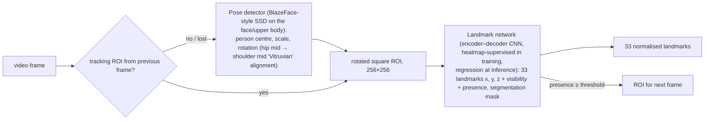

# FormFit computer vision: methods, evaluation and limits

This document covers the computer-vision side of FormFit: the pose model, how landmarks become
reps and form feedback, and how each stage was measured. The numbers in the tables were produced by
`experiments/run.py` with the configs in `experiments/configs/cv_*.json`. Each table names its run
folder under `experiments/results/`.

> **Read the data labels.** Many numbers here come from **synthetic** 3-D skeleton sequences
> (`backend/cv/skeleton.py`). They have exact ground truth, but they are not real people or real
> MediaPipe output. **Real** results: landmark accuracy against human labels on 493 COCO images, and
> rep counting, exercise classification and false reps on 11 real exercise clips (217 reps). Real
> results disagree with synthetic ones in places, and where they do, the real numbers win. Every table says which kind it is.

## 1. Image classification vs object detection vs pose estimation

| | Image classification | Object detection | Pose estimation |
|---|---|---|---|
| Question | *What* is in the image? | *What* and *where* (box)? | *Where* is each body **joint**? |
| Output | one label (or label distribution) per image | N × (box x, y, w, h + class + score) | per person: K keypoints (x, y [, z]) + confidence each |
| Typical head | global pooling → softmax | box regression + classification per anchor/query | heatmaps (one per joint) or direct coordinate regression |
| Loss | cross-entropy | classification + box (L1 / IoU) | heatmap MSE or coordinate L1, often + visibility BCE |
| Metric | accuracy, F1 | mAP over IoU thresholds | PCK, OKS-based AP, NME |
| FormFit use | – (would need labelled rep videos and says nothing about form) | first stage only: finding the person | the core signal: joint angles, reps and form |

They build on each other. A pose system usually **detects** the person first, then **regresses
keypoints** inside the box. A per-frame exercise **classifier** can then run on the keypoints
instead of on pixels. That is what FormFit does in §5, and it is much cheaper than classifying raw
frames. It is also more robust to clothing and backgrounds, because those never reach the
classifier. The price is that every error of the pose model propagates downstream.

Why pose estimation and not classification on pixels for this app: counting reps and judging form
needs *geometry* (a knee angle of 70° vs 110°), which a class label cannot express. Keypoints are also tiny
(33 × 3 numbers per frame), so everything after the pose model runs in well under a millisecond in
the browser and never needs the video to leave the device.

## 2. Pose estimation architecture (MediaPipe BlazePose / PoseLandmarker)

FormFit uses Google's pretrained **PoseLandmarker** (BlazePose, Bazarevsky et al. 2020). It is not
trained or fine-tuned here. It is a two-stage, top-down, single-person pipeline:



* **Detector.** It runs only when there is no track. It finds the face/upper body and predicts the
  body centre, size and in-plane rotation, so the landmark network always sees an upright,
  centred person. This is why the model is single-person: `numPoses: 1` in `lib/pose-runtime.ts`.
* **Landmark network.** A lightweight CNN regresses 33 keypoints, the BlazePose topology: face 0–10,
  arms and hands 11–22, legs and feet 23–32. During training a heatmap and offset head supervises
  the shared features, and at inference only the regression head runs, which is fast. Each landmark has
  a **visibility** probability (in the image and not occluded) and the pose has a **presence** score.
* **Tracking.** In VIDEO mode the ROI for frame *t+1* comes from the landmarks of frame *t*. The
  detector reruns only when presence drops below `minTrackingConfidence`. This is why VIDEO mode is
  faster than IMAGE mode and why a lost track costs one slower frame.
* **Variants.** `lite`, `full` and `heavy` share the pipeline and differ in landmark-network
  capacity (5.6 / 9.4 / 30.7 MB files). Their speed and agreement are measured in §7.
* **Coordinates.** x is divided by the image width and y by the image height. z is relative depth
  and is not used, because it is too noisy for a monocular webcam.

## 3. Landmarks → geometry

| Step | Where | What |
|---|---|---|
| Landmark detection | `lib/pose-runtime.ts` | 33 landmarks per frame, GPU delegate with CPU fallback, WASM served locally |
| **Landmark guard** (new) | `pose/guard.ts` | left/right swap repair, implausible-joint rejection, short-gap filling (§6) |
| Coordinate normalization | `pose/engine.ts` (aspect), `backend/cv/normalize.py` (classifier) | see below |
| Joint angles | `pose/angles.ts`, `pose/rules.ts` | interior angle ABC = arccos((a−b)·(c−b) / ‖a−b‖‖c−b‖) on aspect-corrected 2-D points; torso lean = angle of hip→shoulder from vertical; hip line = shoulder–hip–ankle angle; valgus = knee width / ankle width |
| Temporal smoothing | `pose/angles.ts` | One Euro filter per signal |
| Rep counting | `pose/fsm.ts` | hysteresis state machine `top → down → bottom → top` with min/max rep time and partial-rep detection |
| Posture evaluation | `pose/rules.ts` | 17 per-exercise fault rules on per-rep features, gated by tracking confidence |

**Coordinate normalization.** Raw landmarks depend on the image size, where the person stands, how
far away they are and the camera's rotation, and none of that says anything about the movement.

1. *Aspect correction:* `x *= width / height`. Without it, every angle in a 16:9 video is distorted.
   This was a real bug, found on a real clip.
2. *Translation:* subtract the hip midpoint.
3. *Scale:* divide by a body size, `max(torso, ½·hip-to-ankle, shoulder width)` per frame with the
   median over the window. The torso alone collapses when it points at the camera, as in a push-up
   filmed from the front.
4. *Mirror augmentation* (training only): `x → −x` with left/right indices swapped.
5. **Rotation is not normalised on purpose.** Gravity ("down" in the image) is what separates a
   push-up from a squat.

The rule engine needs only steps 1 and 2, because angles are scale-invariant. The exercise
classifier uses all of them (`backend/cv/normalize.py: frame_features`, 51 features: normalised
x/y and visibility of 12 body joints, 8 joint angles, trunk angle, shank angles, a view cue and
wrist height).

## 4. Synthetic 3-D ground truth (`backend/cv/skeleton.py`)

There is no downloadable dataset that has, for the same videos, keypoints, rep boundaries,
exercise labels and form-fault labels across many camera angles. So most of the evaluation uses a 3-D
kinematic generator:

* **Bodies:** height 1.55–1.95 m, Winter (2009) segment ratios ± 5%.
* **Movement:** forward kinematics plus two-bone IK for 5 exercises, with per-rep depth, tempo and
  injected faults. Examples: squat valgus, heel lift and balance-driven lean; push-up sag/pike and
  elbow flare; curl drift, swing and alternating arms; press arch and short lockout; lunge depth and lean. There are
  also 5 non-exercise distractors: idle, marching, arm waving, hip hinge and walking across.
* **Nuisance factors randomised on purpose:** arm posture during squats and lunges (forward, chest,
  hips, at the sides, behind the head) and squat stance width. See §7 for why.
* **Camera:** pinhole projection at any yaw (0° = facing, 90° = side), height 0.5–1.5 m,
  45–65° FOV, landscape or portrait.
* **Detector error model:** AR(1) pixel noise of 0.3–1% of body height, visibility from
  self-occlusion, occluder boxes (25% of sequences), detection dropouts, left/right swap episodes in
  side views, and badly framed shots.
* **Labels from the true 3-D pose** with the same thresholds as `pose/rules.ts`. The engine sees
  only the noisy 2-D projection, so projection effects count as errors, as they would with a real camera.

Splits (independent seeds): `train` 2,000, `val` 400, `test` 800 sequences; `test_hard` 600 (noise
1.2–2.5%, occluders in 70%); `sweep` 600 (5 exercises × 8 yaws × 15, no occluders).
Regenerate them with the commands in §12.

## 5. Exercise classification: pose-based vs temporal (advanced comparison)

Run: `experiments/results/20261126-170343-cv_classification` (**synthetic**). Six classes: 5 exercises
plus `other` (idle, marching, arm waving, hip hinge, walking). Windows are 2 s (30 frames at 15 fps).

| Model | What it sees | How |
|---|---|---|
| **frame** (pose-based) | one frame's 51 features | gradient-boosted trees; window = mean of 30 frame probabilities, so the order of frames is invisible |
| **stats** | the window, summarised | mean / std / min / max / mean \|velocity\| of the angle and position features → gradient-boosted trees |
| **tcn** (temporal) | the window, frame by frame | 1-D temporal CNN: 3 dilated conv layers (k = 5, 5, 3; dilation 1, 2, 4; 48 channels; receptive field 23 frames ≈ 1.5 s), global average + max pooling, linear head. 31,398 parameters. Trained with JAX (AdamW, 2,500 steps, augmentations: time warp 0.8–1.25×, feature noise, whole-joint dropout, mirroring) |

Macro F1 on synthetic data:

| Protocol | frame (pose-based) | stats | tcn (temporal) |
|---|---|---|---|
| Standard test, 17,000 windows | 0.987 | **0.995** | 0.993 |
| Hard test: 2–3× landmark noise, occluders in 70% of sequences | 0.967 | 0.918 | **0.972** |
| 1-second windows (15 frames, resampled) | **0.982** | 0.953 | 0.954 |
| **Cross-view**: trained on side/oblique cameras only, tested on front/rear | 0.821 | **0.940** | 0.935 |
| `other` class F1 on the hard test | 0.909 | 0.795 | **0.933** |
| Latency per window, CPU, batch 1 | 16.8 ms | 7.0 ms | **0.14 ms** (NumPy), 0.9 ms (TypeScript in Node) |

And on **real video** (`20261126-171149-cv_real_clips`; 493 windows from the 11 clips in
`data/real_clips/manifest.json`, labelled with each clip's exercise; 4 exercises present, no press, no `other`):

| | frame (pose-based) | tcn (temporal) |
|---|---|---|
| Window accuracy | **0.826** | 0.779 |
| Macro F1 (present classes) | **0.700** | 0.625 |
| Clips whose majority vote is right | 10 / 11 | 10 / 11 |

What this shows:

* **On synthetic data from familiar viewpoints all three are near-perfect.** The synthetic exercises are
  very distinct, so on in-distribution data this benchmark separates the models less than real
  footage would.
* **Generalising to an unseen viewpoint is where a single frame fails.** A frontal squat frame looks
  nothing like a side-on one, so the per-frame model drops to F1 0.82. Both temporal models stay at
  0.94, because *how the joints move* changes less with the viewpoint than the static shape does.
* **Under heavy noise and occlusion the learned temporal model is best (0.972)** and is clearly the best at
  telling exercise from non-exercise movement (`other` F1 0.933). Hand-made window statistics are the most
  fragile (0.918), because a few corrupted frames move min/max features a lot.
* **With very short windows the single-frame model wins.** One second is less than one rep.
* **On real video the order flips: the single-frame model is better (0.83 vs 0.78 window accuracy).**
  The temporal model learned more about *synthetic motion* (exact tempo curves, rigid segments), and
  that transfers worse than static pose shape does. Both models get the majority vote right on 10 of 11 clips.
  Both fail completely on the one curl clip, which is a kneeling, no-weights, arms-out-to-the-sides variant that no
  synthetic sequence resembles.
* **Speed:** the TCN is ~100× faster than the tree models on a window, which is why it is the one shipped
  to the browser (`frontend/public/models/exercise_tcn.json`, 292 KB). On real data its lower accuracy is
  acceptable for its job (a conservative gate, §8). A model trained on labelled real clips is the clear next step.

Online use: in the browser the body-size scale comes from the 30-frame window only, not the whole
sequence. With window-only features the TCN scores macro F1 0.992 on 6,449 synthetic test windows
(`python -m cv.export_tcn`). A parity test (`pose/__tests__/exercise.test.ts`) checks that the TypeScript
features and probabilities match NumPy to within 2·10⁻³.

## 6. Occlusion handling and incorrect-pose detection (`pose/guard.ts`)

The guard runs on every frame before the rep engine. It works online with no look-ahead and costs
~0.004 ms per frame:

1. **Left/right swap repair.** In side views the network sometimes swaps the near and far leg for a
   few frames. The guard compares the frame with the previous output under the identity and the
   swapped labelling and keeps the cheaper one, a two-hypothesis data association.
2. **Implausible-joint rejection (incorrect pose).** A joint moving faster than 8 torso lengths per
   second is a detection error, so it is marked invisible. If ≥ 5 joints jump at once, the whole frame
   is rejected (for example, the detector jumped to another person).
3. **Short-gap filling.** A joint hidden for ≤ 0.6 s, or a whole dropped frame, is held at its last
   trusted position with visibility 0.55. That keeps the rep in progress, and the reduced
   visibility lowers the rep's confidence, so its form is more likely to be left unscored. Longer gaps are left missing,
   because guessing for longer would invent motion.

Existing confidence-based handling stays in place: missing joints give "Step back…", weak tracking
gives "Can't see your knees clearly", and a low-confidence rep is counted but not scored.

**A real-video finding that motivates the speed check** (`20261126-145152-cv_landmarks`, real frames,
grey boxes over a joint for 82 of 213 frames): MediaPipe keeps reporting covered joints with
visibility **0.71** (0.79 when uncovered), but their positions are wrong: PCK@0.1 **0.15** vs 0.98
for the same joints without a box. **Visibility alone does not detect occlusion by an object**,
because the network hallucinates a plausible joint. Temporal plausibility checks and per-rep
confidence are needed on top.

Effect on rep counting (**synthetic**, `20261126-171003-cv_repcount`):

| | Guard off | Guard on |
|---|---|---|
| Test: count MAE / exact | 1.754 / 44.8% | **1.743 / 47.6%** |
| Test, sequences with an occluder: MAE / exact | 2.065 / 22.6% | **1.917 / 33.9%** |
| Reps missed because of occlusion (test) | 129 | **97** (−25%) |
| Extra reps from tracking glitches / double counts (test) | 7 | **0** |
| Hard test: MAE / exact | 2.154 / 33.9% | **2.053 / 38.8%** |
| Hard test, reps missed because of occlusion | 241 | **181** (−25%) |
| Engine time per frame (Node) | 0.008 ms | 0.012 ms |

On the 11 real clips the guard changes nothing (same counts with and without). Those clips have no
occlusion or swap events, which is consistent with it being harmless when tracking is clean. The guard is on by default in the app.

## 7. Landmark detection accuracy, latency and low light

**Against human labels: COCO keypoints** (`experiments/results/20261126-coco_pck`, `python -m experiments.cv.coco_pck
--parquet …`). 493 images of a single, clearly visible person (≥ 12 labelled joints, box ≥ 96×96 px) from the COCO
2017 validation keypoints (Hugging Face mirror `rom1x38/COCO_keypoints`, val split). Each image is cropped to the person
box + 25% and run in IMAGE mode. PCK uses the torso diameter (left shoulder to right hip). OKS uses the
COCO sigmas, but with the box area instead of the segmentation area (not in this mirror), so it is slightly lenient.

| Model | Person not detected | PCK@0.1 | PCK@0.2 | PCK@0.2, detected people only | mean OKS | OKS ≥ 0.5 / ≥ 0.75 |
|---|---|---|---|---|---|---|
| **lite** (shipped) | 39 / 493 (7.9%) | 0.574 | 0.760 | 0.822 | 0.789 | 88% / 79% |
| full | 38 / 493 | 0.633 | 0.796 | 0.860 | 0.813 | 88% / 82% |
| heavy | 36 / 493 | 0.683 | 0.819 | 0.880 | 0.832 | 90% / 84% |

COCO photos (sports, street scenes, partial bodies, odd angles) are much harder than a person filming
a workout, so these are lower bounds for FormFit's use. Per joint, lite's PCK@0.2 is lowest for ankles,
knees and hips, the joints the leg exercises depend on (per-joint table in the result JSON).

**Model variants and latency on the bundled workout clip** (`20261126-145152-cv_landmarks`, 213 frames,
640×360; reference = heavy on the same frames, so these are agreement numbers):

| Model | File | CPU latency / frame (median, p95) | PCK@0.05 | PCK@0.1 | PCK@0.2 | NME |
|---|---|---|---|---|---|---|
| **lite** (shipped) | 5.8 MB | **13.2 ms**, 19.1 ms | 0.518 | 0.887 | 0.980 | 0.059 |
| full | 9.4 MB | 18.1 ms, 24.1 ms | 0.710 | 0.945 | 0.991 | 0.045 |
| heavy (reference) | 30.7 MB | 57.2 ms, 66.7 ms | – | – | – | – |

Python MediaPipe on 4 CPU cores, VIDEO mode. The browser uses the WASM build of the same model with a GPU delegate
where available. All three models count the clip's 4 reps.

**Low light** (lite model; frames darkened in linear light with shot and read noise and 8-bit quantisation):

| Light level | Mean luminance | Raw PCK@0.1 | + gain (canvas `brightness()`) | + gamma + CLAHE | Reps counted (raw) |
|---|---|---|---|---|---|
| 100% (clean) | ~0.5 | 0.887 | – | – | 4 / 4 |
| 50% | 0.26 | 0.878 | 0.865 | 0.837 | 4 / 4 |
| 25% | 0.19 | 0.860 | 0.845 | 0.780 | 4 / 4 |
| 12% | 0.13 | 0.833 | 0.774 | 0.669 | 4 / 4 |
| 6% | 0.09 | 0.680 | 0.647 | 0.461 | 4 / 4 (gamma + CLAHE: only 2–3 scored) |

* MediaPipe lite degrades gracefully down to about 12% light. Detection stays at 100% and the rep count stays right.
* **Image enhancement made the landmarks worse at every level.** Brightening amplifies the sensor noise
  as much as the signal, and CLAHE adds local-contrast artefacts the network was not trained on.
  So FormFit does **not** enhance frames. It measures the scene brightness once a second
  (`lib/lighting.ts`, a 32×18 thumbnail) and shows "Room is dark: add light in front of you" below
  luminance 0.11, where accuracy starts to fall off.

**A sim-to-real lesson found on the real clips.** The first version of the generator always had
squatters hold their arms forward and lungers put their hands on their hips. The TCN learned that
shortcut: on real front-view squats (hands at the waist) it answered "lunge" in **100%** of windows, and the gate
(§8) then blocked real reps. Comparing real and synthetic features showed wrist height as the biggest gap
(real squats 0.67, synthetic squats 0.08, synthetic lunges 0.80 in body units). Randomising arm posture and
squat stance width in the generator fixed it: real front-view squats are now classified correctly in 86–100%
of windows. Because the cause was found by looking at these clips, the post-fix real-clip numbers are not
a fully blind test. The earlier run is kept as `20261126-165737-cv_real_clips`.

## 8. Rep counting, false repetitions and posture

Synthetic numbers come from run `20261126-171003-cv_repcount`, real-video numbers from `20261126-171149-cv_real_clips`.
Every number comes from `frontend/src/pose/engine.ts` itself (`scripts/eval-synthetic.ts`), with the guard on unless stated.
A predicted rep matches a ground-truth rep if it closes between the GT turning point and GT end + 1.2 s.

**Rep counting accuracy, real video** (11 clips, 217 reps; 6 filmed people, 5 rendered avatars):

| Configuration | MAE (reps/clip) | Exact | Within ±1 | Reps counted |
|---|---|---|---|---|
| Engine only | 4.27 | 45% | 73% | 172 / 217 |
| + guard | 4.27 | 45% | 73% | 172 / 217 |
| + guard + gate (default) | 6.45 | 36% | 55% | 146 / 217 |
| + gate, user taps "Count anyway" on the curl clip | 4.45 | 36% | 64% | 170 / 217 |

* The gate costs 26 real reps: all 24 on the kneeling curl variant, and 2 on one push-up clip.
* That is why vetoed reps are **kept, not dropped**. The HUD shows "N not counted" and a "Count anyway"
  button that restores them and turns the gate off for the session.
* One filmed squat clip (`pub_squat_042`, 40 shallow "drop squats") gets 0 reps in every configuration:
  the knee never goes below the 115° bottom threshold. That clip alone accounts for 40 of the 45-rep shortfall.
* The earlier real run (2026-09-16) reported MAE 4.0 and 64% exact. The engine is the same; the landmarks
  were re-extracted with a newer MediaPipe Python build (1.2.3), which moved two clips by one rep each.

**Rep counting accuracy, synthetic** (618 exercise sequences, 5,008 reps):

| | MAE (reps/set) | Exact | Within ±1 | Rep precision | Rep recall |
|---|---|---|---|---|---|
| All | 1.74 | 48% | 65% | **1.000** | 0.785 |
| Squat | 2.02 | 33% | – | 1.000 | 0.759 |
| Push-up | 3.22 | 31% | – | 1.000 | 0.612 |
| Curl | 2.15 | 40% | – | 1.000 | 0.744 |
| Press | **0.11** | **92%** | – | 1.000 | **0.987** |
| Lunge | 1.32 | 43% | – | 1.000 | 0.823 |

On synthetic data the counter almost never invents a rep from the person's own set (precision 1.000). It errs by
**missing** reps. Curl recall is low because half the synthetic curl sets alternate arms, and the engine
follows the more visible arm only. Push-ups seen from behind are covered in §9. The miss taxonomy (test, guard on):

| Why a rep was missed | Count |
|---|---|
| Partial range: the rep never reached the bottom threshold (by design the app says "Go lower" instead of counting) | 422 |
| Unfavourable view (front/rear for squat, lunge, curl, push-up) | 162 |
| Occlusion during the rep | 97 |
| Body partly out of frame | 88 |
| Other (mostly the non-working arm in alternating curls, and push-ups with flared elbows) | 308 |

**False repetitions: the wrong movement being counted.** Every clip and test sequence was also run with every
*other* exercise selected (the user picked "curl" but is doing push-ups, or is just waving):

| | No gate | With TCN gate (τ = 0.8) |
|---|---|---|
| **Real video**, wrong exercise selected | **9.42 reps/min** (317 reps) | **0.15 reps/min** (5 reps) |
| Synthetic, all mismatched combinations | 4.23 reps/min | 0.018 reps/min |
| Synthetic, non-exercise movement only | 1.10 reps/min | 0.046 reps/min |
| Synthetic: push-up counter ← curls / curl counter ← presses / lunge counter ← squats | 12.8 / 15.6 / 15.5 | 0.02 / 0.04 / 0.06 |
| Real: press, curl, push-up and lunge counters ← squats | 51 / 43 / 47 / 46 reps | 0 / 0 / 0 / 0 |
| Real: squat counter ← lunges | 69 reps | 5 reps |

* Why: each counter watches one joint angle. Any movement that swings that angle through both thresholds is a
  "rep", including the knee bend of a lunge when the squat counter is selected.
* **The fix is the temporal classifier as a gate.** When the counter closes a rep, the TCN looks at
  the last 2 s. If it is ≥ τ confident that this was a *different* movement, the rep is not counted
  and the user hears "That didn't look like a squat, not counted".
* Cost: synthetic, 4 of 3,931 true reps; real, 26 of 172 (24 of them on the out-of-distribution curl variant,
  recoverable with one tap). τ = 0.8 is shipped (τ = 0.5 blocks slightly more synthetic false reps, 0.005/min, but vetoes more true reps).

**Posture evaluation (synthetic).** Rule faults are compared with faults computed from the true 3-D pose.
3,931 reps were matched and 78.5% were confident enough to be scored:

| | Precision | Recall | Support |
|---|---|---|---|
| Any fault (rep is faulty) | 0.774 | 0.631 | 1,289 faulty reps (1,560 clean) |
| Side view | 0.883 | 0.758 | 359 |
| Oblique | 0.801 | 0.644 | 362 |
| Front | 0.519 | 0.533 | 150 |
| Rear | 0.584 | 0.460 | 113 |

Many rules have high precision and low recall: elbow drift 0.99 / 0.65, torso swing 0.98 / 0.63, back arch
0.97 / 0.32, no lockout 1.00 / 0.09, partial extension 0.86 / 0.05. They rarely raise false
alarms but miss mild cases, because **2-D projection under-reads 3-D angles**: an arm that stops 20°
short looks straight when it points partly toward the camera. Hip sag (0.72 / 0.93) and hip pike
(0.57 / 1.00) are the reverse: very sensitive, with false alarms from foreshortening. Shallow push-up
(0.05 / 0.88) has almost no true cases here and many false alarms from flared elbows. Knee valgus (0.58 / 0.69)
needs a frontal view to be measured at all. **Real-video posture precision/recall still needs coach-labelled reps.**

## 9. Performance under different camera angles (synthetic sweep)

`sweep`: 5 exercises × 8 yaws × 15 sequences, no occluders. 0° = camera in front of the person, 90° / 270° = side.

| Yaw | Rep MAE | Exact | Rep recall | Worst exercise (MAE) | Posture P / R (any fault) | Reps form-scored |
|---|---|---|---|---|---|---|
| 0° (front) | 3.11 | 29% | 0.58 | lunge 4.9 | 0.68 / 0.67 | 69% |
| 45° | 1.13 | 49% | 0.85 | curl 2.5 | 0.86 / 0.73 | 76% |
| **90° (side)** | **1.04** | 56% | **0.87** | curl 2.2 | **0.90 / 0.82** | 71% |
| 135° | 2.28 | 47% | 0.72 | push-up 7.2 | 0.82 / 0.66 | 66% |
| 180° (rear) | 2.40 | 44% | 0.70 | lunge 5.1 | 0.43 / 0.53 | 70% |
| 225° | 2.56 | 41% | 0.68 | push-up 7.6 | 0.84 / 0.67 | 72% |
| **270° (side)** | **1.01** | **63%** | **0.88** | curl 2.1 | **0.93 / 0.82** | 77% |
| 315° | 1.52 | 51% | 0.81 | squat 2.5 | 0.82 / 0.74 | 82% |

* **Side views are 2–3× more accurate than front and rear for counting** (MAE ≈ 1.0 vs 2.4–3.1). From the front a
  squat's or lunge's knee flexion points at the camera and the 2-D knee angle barely changes.
* **Push-ups filmed from behind-and-to-the-side (135°/225°) are the worst cell.** With elbows flared
  15–55°, the 2-D elbow angle at the bottom can read 20–30° larger than the true angle and then never crosses the bottom threshold.
* **Posture precision collapses from the rear (0.43)** because lean and depth are hidden.
* The press is view-independent (MAE ≤ 0.2 at every yaw), because the elbow angle is large in every projection.
* The real clips agree: side-view push-ups and lunges are counted within 0–2 reps, and the failures are
  front-view squats (`pub_squat_042`).
* The app's setup hints ("Side-on or 45°") match these numbers. The exercise classifier, by contrast,
  is view-robust on synthetic data: accuracy ≥ 0.985 at every yaw for all three models.

## 10. Latency budget (per analysed frame)

| Stage | Where | Time |
|---|---|---|
| Pose landmarks, lite | browser (WASM/GPU); measured here in Python on CPU | 13.2 ms median (CPU) |
| Landmark guard | browser | ~0.004 ms |
| Geometry + One Euro + FSM + rules | browser | 0.008 ms |
| Exercise TCN (every 5th frame, plus once per closed rep) | browser | 0.9 ms per call (Node), ≈ 0.2 ms per frame amortised |
| Server form classifier | FastAPI, once per session | batched `predict_proba` |

Everything after the pose model costs < 2% of the pose model's time, so the frame rate is set by
MediaPipe alone. That is also why `lite` is shipped: `full` agrees better with `heavy` (PCK@0.05
0.71 vs 0.52) but is 37% slower, and `heavy` is 4× slower.

## 11. Reproduce

```bash
cd backend
pip install -r requirements-eval.txt          # mediapipe, opencv, jax[cpu]
python -m cv.dataset --name train --n 2000 --seed 101
python -m cv.dataset --name val --n 400 --seed 202
python -m cv.dataset --name test --n 800 --seed 303
python -m cv.dataset --name test_hard --n 600 --seed 505 --occlusion-p 0.7 --noise 0.012 0.025
python -m cv.dataset --name sweep --sweep --per-cell 15 --seed 404
cd ..
python -m experiments.run --config experiments/configs/cv_classification.json   # ~10 min on 4 CPUs
python -m experiments.run --config experiments/configs/cv_repcount.json         # ~5 min
python -m experiments.run --config experiments/configs/cv_landmarks.json        # ~3 min
(cd backend && python -m cv.export_tcn)                                         # browser weights + parity fixture
python -m experiments.real_clips.fetch                                           # 11 real clips (Hugging Face + bundled)
python -m experiments.run --config experiments/configs/real_clips_repcount.json  # extracts landmarks
python -m experiments.run --config experiments/configs/cv_real_clips.json        # guard / gate / classification on real clips
# COCO keypoints val split (436 MB parquet): huggingface.co/datasets/rom1x38/COCO_keypoints, data/val-00000-of-00001.parquet
python -m experiments.cv.coco_pck --parquet data/coco/val.parquet --model lite --max 1000 --out lite.json
```

## 12. Limitations

* Many headline numbers are **synthetic**. The generator's error model (noise, swaps, occluders) is a
  guess at MediaPipe's behaviour, and its bodies are rigid stick figures. Treat those numbers as
  *relative* comparisons (which model, which view, guard on vs off), not as real-world accuracy. Where real and
  synthetic disagree (exercise classification: the single-frame model is better on real video), trust the real result.
* The real-video set is small: 11 clips, 4 exercises, no press and no non-exercise footage; 5 of the clips are rendered avatars.
  One clip (kneeling curls) is far outside what the classifier was trained on. The sim-to-real fix in §7 was found by
  looking at these clips, so they are not a fully blind test of it.
* Posture precision/recall on real video still needs reps labelled by a coach. No public dataset has them.
* COCO OKS uses the box area instead of the segmentation area (not in the mirror used), which makes it slightly lenient.
  PCK is unaffected.
* The temporal gate can veto real reps of an unusual variant (it vetoed all 24 kneeling curls). Vetoed reps are kept,
  and one tap ("Count anyway") restores them and turns the gate off for the session.
* The next step with the best expected payoff is training the exercise classifier on labelled real clips,
  or fine-tuning the synthetic one on them.
